  
  
  
  
  
  

### `> whoami`

Offensive Security Engineer and Security Researcher from Santiago, Chile, with 7+ years in ethical hacking
and Red Team for banking, telecom and enterprise. I break **web, mobile and API** targets, hunt IPTV piracy
(3000+ illegal sources identified) and build **AI agents** that automate offensive work.
Bug bounty hunter on HackerOne and member of **Team Chile**, the national bug bounty team.

  
  
  
  
  

### `> stats`

### `> ls ~/projects`

<table>
  <tr>
    <td width="50%"></td>
    <td width="50%"></td>
  </tr>
  <tr>
    <td width="50%"></td>
    <td width="50%"></td>
  </tr>
  <tr>
    <td width="50%"></td>
    <td width="50%"></td>
  </tr>
</table>

### `> ls ~/tools`

| Tool | What it does |
|------|--------------|
| [**guillotine**](https://github.com/Gohanckz/guillotine) | HTTP security header detection |
| [**badhash**](https://github.com/Gohanckz/badhash) | Reverse password brute force |
| [**CookieSpam**](https://github.com/Gohanckz/CookieSpam) | Session hijacking tests |
| [**jsdump**](https://github.com/Gohanckz/jsdump) | JavaScript extraction for recon |

<picture>
  <source media="(prefers-color-scheme: dark)" srcset="assets/snake-dark.svg">
  <source media="(prefers-color-scheme: light)" srcset="assets/snake-light.svg">
  
</picture>

  

Banner, stats and project cards are generated by <a href="scripts/build.py"><code>scripts/build.py</code></a> and refreshed daily by GitHub Actions.
